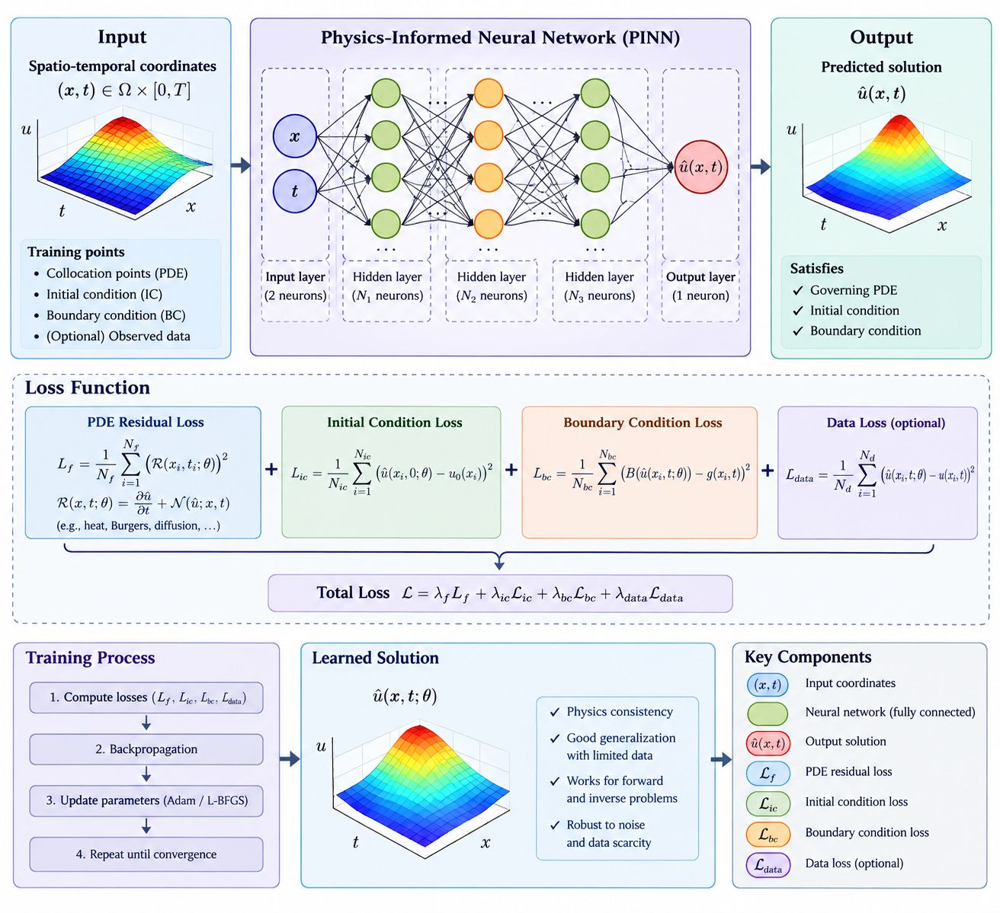

# PINN Benchmark Framework

Code for a systematic benchmark of Physics-Informed Neural Networks (PINNs) on three problems:
the 1D **heat equation**, the 1D **Burgers equation**, and an **inverse diffusion** problem
(joint recovery of the solution and the diffusion coefficient `C`). Three model families are compared:

| Model | Description |
|-------|-------------|
| **Data-Driven** | Neural network trained on labeled data only |
| **Pure PINN** | Physics loss only (PDE + boundary/initial conditions), no labeled data |
| **Hybrid** | Physics loss combined with labeled data |

<p align="center">
  
</p>
<p align="center"><em>Overview of the physics-informed neural network (PINN) framework used in this benchmark: input coordinates, fully connected network, composite loss (PDE residual, initial condition, boundary condition and optional data terms) and training loop.</em></p>

The study is organized in four phases:

| Phase | Question | Problems |
|-------|----------|----------|
| 1. Data scarcity | How do the models behave as the fraction of labeled data shrinks? | Heat, Burgers, Inverse |
| 2. Noise robustness | How sensitive are they to noise in the labeled data? | Heat, Burgers, Inverse |
| 3. Temporal extrapolation | How well do they predict beyond the training time window? | Heat, Burgers |
| 4. Sensitivity analysis | How sensitive is the Hybrid model to the PDE-residual loss weight λ, network depth and activation function? | Heat, Burgers, Inverse (λ only) |

## Repository structure

```
.
├── 1_data_scarcity/
│   ├── heat_equation.py
│   ├── burgers_equation.py
│   ├── inverse_diffusion.py
│   └── *_plots*.py                    # figure scripts
├── 2_noise_robustness/
│   ├── heat_equation.py
│   ├── burgers_equation.py
│   ├── inverse_diffusion.py
│   └── burgers_equation_plots_*.py
├── 3_temporal_extrapolation/
│   ├── heat_equation_restricted_physics.py
│   ├── heat_equation_full_domain_physics.py
│   ├── burgers_equation_restricted_physics.py
│   ├── burgers_equation_full_domain_physics.py
│   └── burgers_equation_plots.py
├── 4_sensitivity_analysis/
│   ├── heat_equation.py
│   ├── burgers_equation.py
│   └── inverse_diffusion.py
├── assets/
│   └── pinn_framework_overview.jpg    # overview figure used in this README
├── requirements.txt
└── LICENSE
```

Phase 3 has two variants per equation:

- **restricted physics**: PDE collocation points of the PINN models lie only in `[0, t_train]`, so all models share the same information window.
- **full-domain physics**: collocation points cover the whole time domain, including the extrapolation region.

In Phase 4, λ multiplies the PDE-residual term of the Hybrid loss (`loss_weights = [λ, 1, 1, 1]` for PDE, BC, IC and data), with λ ∈ {0.01, 0.1, 1, 10}. For the heat and Burgers equations, λ is crossed with three depths ([50]×3, [50]×5, [50]×8) and two activations (tanh, GELU); for the inverse problem, only λ is varied ([32]×3, tanh).

## Mapping to the paper

| Paper section | Content | Scripts |
|---------------|---------|---------|
| 5.1 Data scarcity | Tables 1-4, Figs. 1-10 | `1_data_scarcity/` |
| 5.2 Noise robustness | Tables 5-9, Figs. 11-21 | `2_noise_robustness/` |
| 5.3 Temporal extrapolation | Tables 10-11, Figs. 22-28 | `3_temporal_extrapolation/*_full_domain_physics.py` (restricted-physics scripts are the counterpart variant) |
| 5.4 Sensitivity analysis | Tables 12-14, Figs. 29-46 | `4_sensitivity_analysis/` (includes Friedman and Holm-corrected Wilcoxon tests) |

## Installation

```bash
git clone <repository-url>
cd <repository-name>
pip install -r requirements.txt
```

The scripts use DeepXDE with the PyTorch backend (`DDE_BACKEND=pytorch` is set inside each script).
A CUDA-capable GPU is strongly recommended; the experiments were run in Kaggle notebooks.

## Usage

Each script is self-contained. Run it from the directory where you want the outputs (CSV files, figures and, in phase 3, checkpoints) to be written:

```bash
python 1_data_scarcity/heat_equation.py
python 2_noise_robustness/burgers_equation.py
python 3_temporal_extrapolation/heat_equation_restricted_physics.py
python 4_sensitivity_analysis/inverse_diffusion.py
```

- The Burgers experiments download the reference dataset `Burgers.npz` from the DeepXDE repository on first run.
- Phase 3 and 4 scripts save intermediate CSV files and can resume an interrupted run.
- The `*_plots*.py` scripts regenerate the figures from the summary results of the corresponding experiment (the numbers are stored at the top of each script).

## Reproducibility

- **Repetitions:** every setting is repeated over 6 independent runs and reported as mean ± std.
- **Fixed holdout set:** 20% of the reference grid is held out once (seed `9999`) and is never used for training or for sampling labeled points; all models are evaluated on it.
- **Labeled data:** sampled only from the remaining pool. In Phase 1 (heat, Burgers, inverse) a fixed base subset of the pool is chosen once (seed `4242`) and smaller fractions are drawn from it.
- **Noise (Phase 2):** generated with an RNG independent of the network-initialization seed; the same labeled sample is reused across noise levels within a run.
- **Training budget:** identical for all compared models. Forward problems (heat, Burgers): Adam (15,000 iterations) followed by L-BFGS. Inverse problem: Adam only, 50,000 iterations (`ADAM_ITERATIONS` / `ADAM_ITERS` at the top of each script).
- **Timing:** in Phases 2-4, a short warm-up run is executed before any timed training, so GPU/backend initialization is excluded from the measured times. In Phase 1, training time is recorded only for the Burgers equation, without a separate warm-up run.

## License

Released under the MIT License. See [LICENSE](LICENSE).
